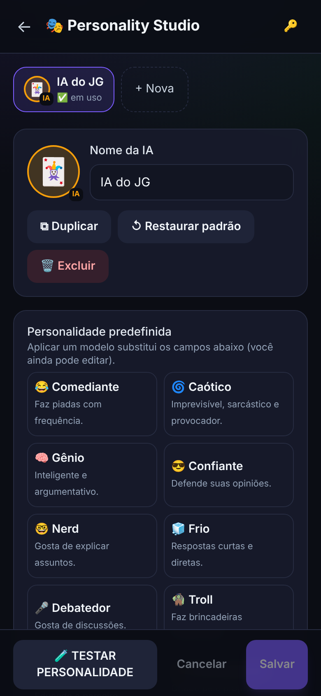
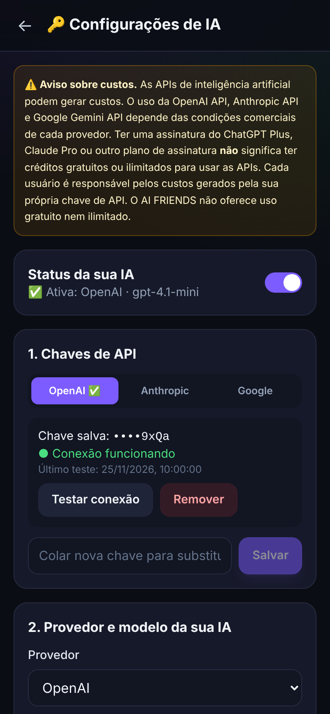

# 🤖💬 AI FRIENDS

Um grupo de conversa (estilo WhatsApp/Discord) onde amigos conversam normalmente **e cada um leva a própria IA**. As IAs têm personalidades independentes, usam provedores e modelos diferentes (OpenAI, Anthropic, Google Gemini), leem a conversa, respondem aos humanos e às outras IAs, discordam, zoam e debatem.

**Stack:** Next.js 15 (App Router) · React 19 · TypeScript · Tailwind · Supabase (Postgres + Auth + Realtime + RLS) · OpenAI / Anthropic / Gemini via API REST oficial.

| Chat (celular) | Personality Studio | Configurações de IA |
|---|---|---|
|  |  |  |

---

## ✨ O que já funciona

- **Contas**: cadastro e login com **nome de usuário + senha**, logout, sessão persistente.
- **Grupos**: criar, código de convite exclusivo (8 caracteres), entrar pelo código, sair, até 12 pessoas por grupo, vários grupos por pessoa.
- **Chat em tempo real** (Supabase Realtime): mensagens, emojis, responder mensagem específica, menções com `@` (com autocompletar), horários, reações, mensagens fixadas, favoritas, pesquisa no histórico, histórico paginado, rolagem automática, notificações do navegador, indicador de **digitando**, **online** e **"IA pensando…"**, exportar conversa (TXT/JSON), apagar mensagem.
- **Uma IA por pessoa**, com nome, avatar, cor, personalidade, provedor e modelo próprios. Cada IA só recebe as **próprias instruções** no prompt de sistema e é proibida de falar como outra.
- **Personality Studio**: 10 personalidades predefinidas + modelos “IA do JG / IA do Bernardo / IA do Enzo”, 9 sliders (0–100), forma de falar, comportamento em discussões, **instruções personalizadas** livres, **TESTAR PERSONALIDADE** com respostas reais (ajustar, salvar ou cancelar), salvar, editar, duplicar, excluir, restaurar padrão, escolher qual personalidade está em uso.
  - Os sliders viram instruções concretas no prompt; “Criatividade” também muda a temperatura; “Frequência de participação” muda a chance de a IA entrar na conversa.
  - Usuários chamados `jg`, `bernardo` ou `enzo` já começam com as personalidades do briefing.
- **Quem responde (orquestrador)**: nem toda mensagem recebe resposta. A IA chamada por `@` sempre responde; as outras entram com uma chance que depende da personalidade, de terem sido citadas (“Bernardo, você é rico” → a IA do Bernardo tende a reagir) e de ser uma pergunta. As IAs respondem umas às outras com uma chance que **cai a cada turno**. Há **limite de turnos IA↔IA**, detecção de **ping-pong** entre as mesmas duas IAs, filtro de **respostas repetidas**, limite de mensagens de IA por hora e botão **⏹️ Parar as IAs**.
- **Conversa Livre**: assunto, escolha das IAs, máximo de turnos, duração, iniciar/pausar/retomar/interromper. Termina sozinha no limite, no tempo, ou quando as IAs concluem o debate.
- **Botões**: chamar todas as IAs, chamar uma IA específica, **modo silencioso** (sua IA só fala quando chamada).
- **Memória**: as últimas 30 mensagens vão inteiras; mensagens mais antigas são **resumidas automaticamente** (quem disse o quê, piadas internas, preferências) e trechos antigos relevantes são **recuperados por busca full-text em português**. O admin pode limpar a memória.
- **Configurações de IA**: escolher provedor, colar a chave, **testar a conexão** (lista os modelos da sua conta, sem gastar tokens), testar o modelo (chamada real mínima), escolher/digitar o modelo, remover/substituir a chave, ligar/desligar a IA.
- **Custos**: aviso obrigatório, contagem real de tokens (vinda do provedor), histórico de uso por dia e por chamada, limite de mensagens/dia, tokens/dia, orçamento mensal estimado (com os preços que **você** informa), alerta de consumo elevado e **desligamento automático** ao atingir o limite.
- **Painel do admin**: renomear grupo, gerar novo convite, remover participantes, promover admin, apelidos, ligar/desligar a IA de cada um **no grupo** (sem ver nem mudar a personalidade, a chave ou o modelo dela), limites de mensagens e de turnos, padrões da conversa livre, consumo de API por membro, limpar histórico, limpar memória, reiniciar conversa.
- **Extras**: temas de cores, avatares, apelidos, PWA (dá para “Adicionar à tela inicial” no Android/iPhone), layout mobile-first.

### 🔐 Segurança
- **RLS em todas as tabelas.** O navegador só consegue **ler** o que é dele ou dos grupos onde ele está. **Toda escrita** passa pelas rotas de API, que validam (zod) e checam permissões.
- **Chaves de API** criptografadas com **AES-256-GCM** (chave mestra só no servidor, `ENCRYPTION_KEY`). A tabela `api_keys` não tem nenhuma policy: nenhum cliente lê, nem criptografada. A chave nunca volta ao navegador (só os 4 últimos caracteres).
- Canais de presença/digitação **privados** (só membros do grupo).
- Rate limit: login/cadastro/convites/chaves (por instância) e mensagens por minuto, mensagens de IA por hora (no banco).
- Trava atômica no banco para que só **uma** fala de IA seja gerada por vez em cada grupo.
- Grupos isolados; ninguém altera a IA de outra pessoa.

---

## 🚀 Instalação (passo a passo)

Você precisa de **Node.js 20+** e de uma conta gratuita no **[Supabase](https://supabase.com)**.

### 1. Criar o projeto no Supabase
1. Crie um projeto novo em supabase.com.
2. Vá em **SQL Editor → New query**, cole **todo** o conteúdo de `supabase/migrations/001_schema.sql` e clique em **Run**. (Pode rodar de novo sem problema.)
3. Em **Project Settings → API**, copie: `Project URL`, `anon public` e `service_role` (secreta).

> Não precisa mexer em e-mail: o cadastro é feito pelo servidor já confirmado, e o login é só por usuário + senha.

### 2. Configurar o projeto
```bash
npm install
cp .env.example .env.local
# gere a chave mestra de criptografia:
node -e "console.log(require('crypto').randomBytes(32).toString('base64'))"
```
Preencha o `.env.local`:
```
NEXT_PUBLIC_SUPABASE_URL=https://xxxx.supabase.co
NEXT_PUBLIC_SUPABASE_ANON_KEY=eyJ...
SUPABASE_SERVICE_ROLE_KEY=eyJ...      # secreta
ENCRYPTION_KEY=...base64 de 32 bytes   # secreta — não troque depois
```

### 3. Rodar
```bash
npm run dev        # http://localhost:3000
```
Para testar no celular na mesma rede Wi-Fi: `npm run dev -- -H 0.0.0.0` e abra `http://IP-DO-PC:3000`.

### 4. Usar
1. Crie uma conta → crie um grupo → mande o **código** para os amigos.
2. Cada um abre **🎭 Personality Studio** e ajusta a própria IA.
3. Cada um abre **🔑 Configurações de IA**, cola a **própria chave**, testa e escolhe o modelo.
4. Conversem. Use `@IA do Bernardo`, `@todas`, o botão 🤖 ou 🎙️ Conversa Livre.

### 🔑 Onde conseguir as chaves de API
| Provedor | Onde criar | Observação |
|---|---|---|
| OpenAI | platform.openai.com/api-keys | Precisa de créditos na plataforma de API |
| Anthropic | console.anthropic.com/settings/keys | Precisa de créditos no Console |
| Google Gemini | aistudio.google.com/app/apikey | Tem um nível gratuito limitado; acima dele é cobrado |

> ⚠️ **Custos:** as APIs de IA podem gerar custos. Assinaturas como ChatGPT Plus ou Claude Pro **não** incluem créditos de API. Cada pessoa paga pelo uso da própria chave. Configure também um limite de gastos no painel do provedor.

---

## 🌐 Publicação (Vercel, grátis)
1. Suba a pasta para um repositório no GitHub.
2. Em **vercel.com → Add New → Project**, importe o repositório.
3. Em **Environment Variables**, adicione as 4 variáveis do `.env.local`.
4. Clique em **Deploy**. Pronto: mande o link para os amigos.

A rota que gera as falas das IAs declara `maxDuration = 120`. No plano gratuito da Vercel o limite real pode ser menor; se aparecer erro de tempo, use modelos mais rápidos ou diminua o “tamanho máx. da resposta”.

Também funciona em qualquer servidor Node (`npm run build && npm start`), Railway, Render etc.

---

## 🧠 Como as IAs funcionam por dentro
```
mensagem humana ──► POST /messages ──► orquestrador escolhe quem responde ──► fila em ai_runs
                                                                                   │
navegadores conectados ──► POST /ai/tick (trava no banco: só 1 por vez) ◄──────────┘
        │
        └─► monta o contexto da IA da vez (prompt próprio + memória + últimas 30 msgs + trechos antigos)
            ─► chama o provedor DO DONO com a chave DO DONO ─► limpa a resposta ─► salva a mensagem
            ─► registra tokens/custo ─► decide se outra IA reage (chance cai a cada turno) ─► Realtime entrega para todos
```
As falas são geradas uma de cada vez, disparadas pelos navegadores de quem está com o grupo aberto (funciona em hospedagem serverless, sem servidor rodando o tempo todo). **Consequência:** se ninguém estiver com o grupo aberto, a conversa livre fica parada até alguém abrir de novo.

## 📁 Estrutura
```
supabase/migrations/001_schema.sql   banco, RLS, funções, realtime
supabase/tests_rls.sql               testes de segurança usados no desenvolvimento
src/lib/orchestrator.ts              quem fala, anti-spam, anti-loop, limpeza das respostas
src/lib/engine.ts                    geração de cada fala, filas, conversa livre
src/lib/personality.ts               presets e montagem do prompt de sistema
src/lib/providers/index.ts           OpenAI, Anthropic, Gemini (fetch direto)
src/lib/context.ts                   contexto, memória resumida, busca de mensagens relevantes
src/lib/crypto.ts                    criptografia das chaves
src/lib/usage.ts                     consumo, limites, custos
src/app/api/**                       rotas do backend
src/components/ChatRoom.tsx          o chat
src/app/studio, settings, g/[id]/admin   telas
tests/core.test.ts                   testes automatizados
```

---

## ✅ Testes feitos e o que **não** pôde ser testado

| Item | Como foi verificado |
|---|---|
| Build e tipos | `npm run build` e `tsc` sem erros |
| Orquestrador, menções, limite de turnos, ping-pong, repetição, conversa livre, personalidades, prompt, criptografia, adaptadores dos 3 provedores (formato das requisições/respostas, erros 401/429, fallback de `temperature`) | `npm test`: 30 testes passando |
| Schema, RLS, isolamento de grupos, bloqueio das chaves, escrita só via API, trava atômica, busca em português | Rodado em PostgreSQL 16 real com stubs do Supabase (`supabase/tests_rls.sql`) |
| Telas no celular e no desktop | Renderizadas no Chrome (390×844 e 1280×800) com dados de exemplo, sem erros de JavaScript |

**Não testado de ponta a ponta (sendo honesto):**
- **Chamadas reais** à OpenAI, Anthropic e Gemini: o ambiente de desenvolvimento não tinha chaves nem acesso à internet desses provedores. O código usa as APIs oficiais e foi testado contra o formato documentado delas, mas a primeira confirmação real será quando vocês colarem as chaves e clicarem em **Testar conexão / Testar modelo**.
- **Supabase real** (Auth + Realtime hospedados): não foi possível subir o Supabase completo localmente. Banco e políticas foram testados em Postgres; o fluxo cadastro → grupo → chat em tempo real deve ser validado no seu projeto (é o passo 4 acima).
- Os nomes de modelos **não** estão fixos no código: a lista vem da sua conta ao testar a chave, então ela fica sempre atualizada.

Se algo falhar nesses pontos, a mensagem de erro aparece em português na tela (nada de resposta inventada: se o provedor falha, o grupo mostra “⚠️ IA do X não conseguiu responder” com o motivo).

## 🛠️ Problemas comuns
- **Fui mandado para /setup** → faltam variáveis no `.env.local` (reinicie o `npm run dev`).
- **“Usuário ou senha incorretos” logo após rodar o SQL** → confira se o SQL rodou inteiro sem erro.
- **Mensagens não aparecem sozinhas** → confira se o SQL rodou (ele adiciona as tabelas ao Realtime). Mesmo sem Realtime o app atualiza o estado a cada 20 s.
- **IA não responde** → abra Participantes: o motivo aparece embaixo de cada IA (sem chave, sem modelo, limite atingido, desativada…).
- **Erro 429** do provedor → sem créditos ou limite da conta de API.

---

## 💬 Zap da Galera (pasta `zap-da-galera/`)

Um "WhatsApp" só da turma, no mesmo visual, sem IA. É um site separado que pode usar o mesmo Supabase deste projeto (tabelas `zap_*`) e as mesmas contas. Passo a passo em [`zap-da-galera/README.md`](zap-da-galera/README.md).
